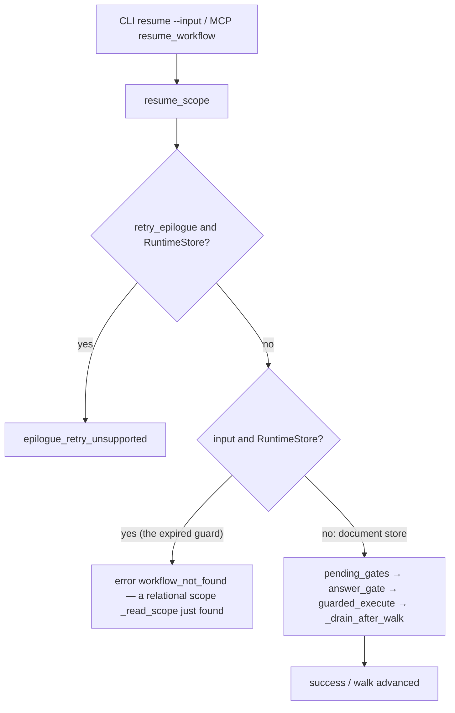
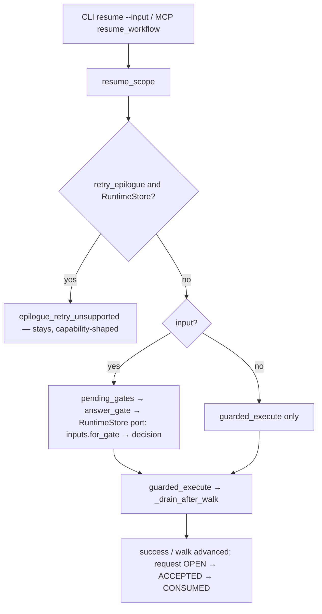

# plan.md — workflow-answer-input-guard

**Phase:** Plan + Execute in one run, by the leader's re-route dispatch
(2026-10-26T13:54:38Z): the designer produced nothing and an interleaved
member gate would have left master red at `11ed0e82`, so this plan's surviving
smells and tasks go to the review lane together with the diff.

## Alignment

Shape: *Shape Intent — Gate Interactions, Evidence, and the Transactional
Outbox*, SD page 20086800, **v2, `Authority: Approved`**, updated
2026-10-19 23:34:46Z, read live 2026-10-26.

In scope, in the page's own words (§1, §5):

- **Command line**: *"`answer` records; `resume` advances"*; the §1
  transcripts — `func builtin workflow answer wf_42 approval --input
  '{"approved":true}' --format json` then `func builtin workflow resume wf_42
  --format json` — are the CLI surface. *"Existing command names, `--input`,
  `--format json`, and the record/advance split are binding."*
- **UI and adapters** (§6: *CLI / TUI / Slack / MCP / agent adapter*): the
  same fusion carries to `resume_workflow`/`get_workflow_state` surfaces;
  *"Adapters render requests and decode responses; their IDs are correlation
  only"* (§8).
- **Configuration** (§5): *"The selected `RuntimeStore` is the sole answer
  authority for this feature."*
- **Runtime records** (§8): *"Selected `RuntimeStore` owns durable request,
  candidate, decision, evidence reference, transition and outbox intent. No
  `scopes.json` read is needed to retrieve interaction evidence."* — the
  record/`OPEN -> ACCEPTED -> CONSUMED` lifecycle this repair restores to the
  fused form.

Out of scope, in the page's own words (§5, §8):

- **Wire, storage, and observable records**: *"Proposed read projection, not
  today's schema or a new HTTP endpoint"* — not touched.
- **Gate decision** (§8): *"Gate validates, applies policy, and authorizes
  continuation. A resolver supplies a candidate only."* — unchanged.
- **Effect delivery** (§8): *"Dispatcher delivers committed intents; receiver
  deduplicates."* — untouched by this repair.
- Provisional spellings (§7): *`supersedes_candidate_id`,
  `observed_candidate_ids`, `policy_id`, `policy_version`, `resolver_class`,
  `channel`, `payload_hash`, `validation`, `causal`, `decision`, `evidence`,
  `idempotency_key`* — not settled here.

The page's §1 surface is what the merged tree broke and this repair restores.

## Retrieval and skills

- **Serena** (`find_symbol`): `resume_scope` in
  `src/functualize/app/_workflow_control.py`; `answer_gate` in
  `src/functualize/app/_workflow_answer.py` (RuntimeStore branch reading
  `store.inputs.for_gate` / `.decision`); `get_scope` in
  `src/functualize/_primitives/scope_store.py` (`_ScopeStoreReader`, the only
  `get_scope` in the tree).
- **rg**: every `isinstance(store, RuntimeStore)` in
  `src/functualize/app/_workflow_control.py` (the `retry_epilogue` refusal at
  `:324`, the guard at `:351`).
- **Skills consulted** (CONSTITUTION.md § plan requirement):
  - `design-patterns-refactoring` (user-level; Refactoring.Guru smell
    catalogue): the smell name *redundant conditional* / dead conditional
    comment — a guard whose stated expiry condition has occurred. The remedy
    is deletion, not restructuring.
  - `functualize-repo-ops` (in-repo): the two-push sequence and the
    `spec-artifacts-cleared` gate shape this plan's delivery.
- **Prior art**: `416420d7` (the guard and its expiry comment),
  `b50c7ad7` (the relational contract), `11ed0e82` (input recording on the
  runtime port), `326f76d7` (pre-push hygiene), `67a8f231` (ADR-033 refusal
  shape). The handoff digest `MCH-215-spec-input.md` is quoted only where it
  cites code verified here.

## BEFORE (base `11ed0e82`)

Smells the BEFORE already carries: *redundant conditional* (the guard, whose
own comment expired at `11ed0e82`); *misplaced comment* — the comment says
"never pass a runtime store to get_scope", a rule `_read_scope` already
follows (`get_scope` exists only on `_ScopeStoreReader`).

## AFTER

The AFTER is the flow `resume_scope`'s own docstring already promises
("Accepting input does not run the workflow, but it can advance an already
running one"); the code now matches the docstring on every store.

## Approach

1. Delete the guard block (spec § *The defect*, the 8 lines at
   `_workflow_control.py:351-357`) — the smallest change that tells the
   truth; nothing replaces it (contracts §4: no capability check is warranted,
   because no store shape still needs the outcome).
2. Re-contract the MCP twin: rename
   `test_sqlite_resume_with_gate_input_returns_a_clean_error` →
   `test_sqlite_resume_with_gate_input_answers_and_advances`, asserting the
   relational vocabulary (port record consumed, walk `["travel_plan", "body"]`,
   success shape, `ScopeStore(...).get_scope("sql-run") is None`).
3. Add the `CHANGELOG.md` `### Fixed` entry in the file's house voice.
4. Gates: relational file `9 passed`; MCP file green; `uv run pytest -x -q
   --no-header` green (the doc scenario's exact command); doc-verify
   `j-dev-contrib` green; `uv run ruff check --fix src/ tests/ plugins/
   examples/`, `uv run ruff format`, `uv run mypy src/`, `uv run lint-imports`.
5. Reachability / sabotage: the production call path is
   `workflow_resume` (`_cli/builtins.py:1538`) → `resume_scope`
   (`app/_workflow_control.py:295`) → `answer_gate`
   (`app/_workflow_answer.py:199`) → `store.inputs` writer, and its MCP twin
   `_resume_workflow` (`functualize_mcp/_workflow_tools.py:374`) →
   `resume_scope`. The sabotage half already exists as the base run: with the
   guard present at `11ed0e82`, exactly
   `test_resume_with_fused_input_answers_and_advances` fails (log
   `/tmp/functualize-repro.log`, `1 failed, 60 passed`); deleting the call is
   the restore, and AC-1/AC-2 watch both surfaces.

## Files to change (hit sets)

| File | Why (hit set) |
| --- | --- |
| `src/functualize/app/_workflow_control.py` | delete `:351-357`, the `input is not None and isinstance(store, RuntimeStore)` refusal in `resume_scope`; the `retry_epilogue` guard at `:324` stays |
| `tests/plugins/test_mcp_workflow_tools.py` | rewrite `test_sqlite_resume_with_gate_input_returns_a_clean_error` (≈`:157`) to the fused contract; fixture `_gated_app(calls, sqlite=True)` reused unchanged |
| `CHANGELOG.md` | `## [Unreleased]` `### Fixed` entry |
| `.spec/features/workflow-answer-input-guard/{spec,contracts,plan,tasks}.md` (new) | this package; cleared before merge |

`tests/cli/test_workflow_answer_relational.py` is in the blast radius but
**not** in the hit set: it is the frozen contract (`b50c7ad7`), asserted green
as AC-1. `answer_gate` (`app/_workflow_answer.py`) already records through
the port and needs no edit — verified by reading its `RuntimeStore` branch and
by `11ed0e82`'s own green run.

## Risks

| Risk | Mitigation |
| --- | --- |
| Deleting the guard un-refuses a call shape some consumer relied on | The outcome was a lie (`workflow_not_found` for a scope that exists) created 3 commits ago on the same branch; contracts §4 states the disappearance as a deliberate behaviour change and the changelog records it |
| The MCP twin's port assertions drift from the relational vocabulary | They copy the relational file's exact predicates (`for_gate`, `decision`, request lifecycle, `get_scope(...) is None`); both files run in AC-1/AC-2 and the full tier (AC-3) |
| A store shape other than `RuntimeStore` still needs a fused-input refusal | None exists: `get_scope` lives only on the document reader (`_primitives/scope_store.py`), and `answer_gate` records through the port for every store `resume_scope` accepts. contracts §4 forbids reintroducing an `isinstance` refusal |

## Surviving smells

- **The `retry_epilogue` `isinstance(store, RuntimeStore)` refusal stays**
  (capability-shaped: the runtime input port has no step deletion). It is not
  part of the expired premise; renaming it to a capability check is a
  contract change and belongs to the port's own follow-up (spec § *Out of
  scope, recorded*).
- **`_workflow_answer.py`'s guard comment** ("This refusal is now local to the
  input gate …") stays truthful but points at no refusal that can still fire
  in `answer_gate` after `11ed0e82`; left untouched to keep the diff one
  concern.
- **The two test files can drift**: the MCP file is a second home for the
  fused contract. Cheapest honest fix is duplication (the relational file is
  frozen); a shared helper would couple a frozen file to a live one.
